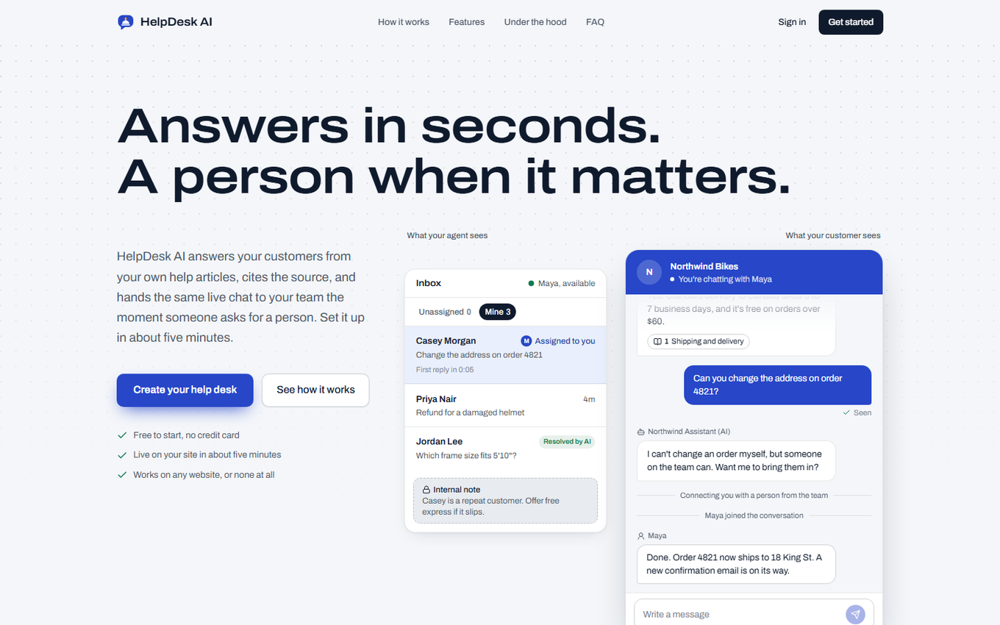
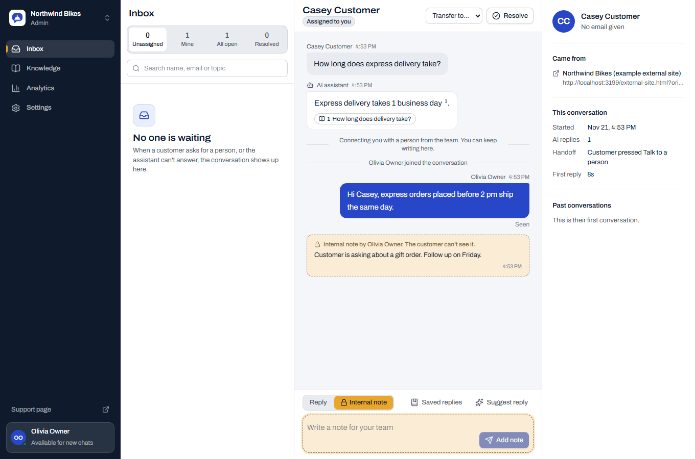
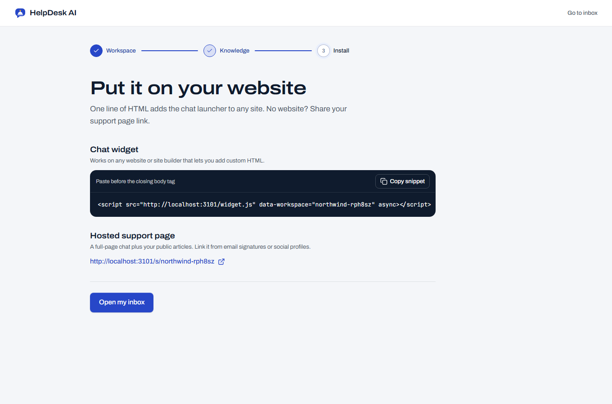

<p align="center">
  
</p>

<h3 align="center">Answers in seconds. A person when it matters.</h3>

<p align="center">
  Customer support a small business can set up in five minutes. An AI assistant answers first, grounded only in the
  business's own help articles, and hands the same live conversation to a human agent the moment a customer asks.
  <br />
  Realtime messaging by <a href="https://www.nexconn.ai">Nexconn</a>. Answers by Gemini.
</p>

<p align="center"><b>Live:</b> <a href="https://helpdesk-ai-five.vercel.app">helpdesk-ai-five.vercel.app</a></p>



## What it is

Most small businesses answer the same twenty questions all day, and lose customers on the one question that needed a
person. HelpDesk AI puts a chat on their site (one `<script>` tag) or on a hosted support page. The assistant answers
from the articles the business wrote, cites the article it used, and says so when it doesn't know. When the customer
asks for a person, or the assistant can't answer, the **same conversation** moves to the team's inbox: an agent joins,
the customer sees who joined, typing and "Seen", and rates the chat when it's resolved. Questions the assistant
couldn't answer come back to the owner as article drafts written from what the agent actually said.

## What it does

**For the business owner**
- Sign up and create a workspace in three steps: name and support page address, brand color (contrast-checked swatches), logo, greeting; then knowledge; then install.
- Knowledge: write FAQs, paste text, or upload `.txt`, `.md` and `.pdf` files (parsed on the server, chunked, embedded with Gemini into pgvector). Articles are public (listed on the support page) or internal.
- Assistant behavior: on/off, name, tone, what to do without an answer (offer a person or hand off right away), extra instructions, round-robin auto-assign.
- Install: one `<script>` tag that adds a launcher and chat panel to any website (cross-origin iframe, full screen on phones), plus a hosted support page `/s/<slug>` with the chat and public articles.
- Team: invite links (single use, 7-day expiry, stored hashed), admin and agent roles, live online status.
- Analytics: conversations per day by outcome, AI-resolved vs handed off, median first response time, average rating, and the questions the assistant couldn't answer, grouped by meaning, each one click from a drafted article.

**For customers**
- A name (email optional) and they're chatting. The answer streams in within seconds, with the source article one tap away.
- "Talk to a person" is always on screen; asking in words works too.
- They see when a person joins, when they're typing, and when their message was read.
- Image and file attachments, a rating card when the conversation is resolved, and their history when they come back.

**For agents**
- Queues: Unassigned, Mine, All open, Resolved, with live counts, unread badges, and a waiting timer that turns brass after two minutes.
- Claim, or receive conversations by round-robin among teammates who are online and available.
- Reply with text, images and files; saved replies; AI-drafted replies to edit; internal notes (amber, never sent to the customer); transfer; resolve and reopen.
- Customer context: name, email, the page they came from, past conversations.

| Agent inbox | AI answer with its source | Analytics |
| --- | --- | --- |
|  |  |  |

| Install | Knowledge | Support page on a phone |
| --- | --- | --- |
|  |  |  |

## How it works

```
 Business website                    HelpDesk AI (Next.js on Vercel, sin1)              Nexconn (Singapore)
 ┌──────────────┐  <script>    ┌───────────────────────────────────────────┐
 │ widget.js    │─────────────▶│ /embed/<slug>  chat UI in an iframe       │──Chat SDK──▶ WebSocket
 │ launcher +   │◀─postMessage─│ /s/<slug>      hosted support page        │
 │ iframe resize│              ├───────────────────────────────────────────┤
 └──────────────┘              │ /app/*         agent console              │──Chat SDK──▶ WebSocket
                               ├───────────────────────────────────────────┤
                               │ /api/*         auth, knowledge, inbox,    │──REST──────▶ Platform Chat API
                               │                widget, AI pipeline        │  tokens, groups, bot and
                               └──────┬───────────────┬────────────────────┘  system messages, streaming,
                                      │               │                       metadata, presence
                               Neon Postgres     Gemini (@google/genai)
                               + pgvector        answers + embeddings
                               Vercel Blob (logos, uploaded documents)
```

1. The customer sends a message with the Chat SDK into the conversation's Nexconn group, then tells our API it was sent.
2. The server checks the customer owns the conversation, mirrors the message in Postgres, and in `after()` runs the AI pipeline: triage (question, small talk, or "I want a person") → vector search over the workspace's articles → Gemini answer that must cite a passage or reply `NO_ANSWER`.
3. The answer is streamed into one Nexconn streaming message sent by the workspace's bot user; citations ride along in the message metadata.
4. On handoff, the conversation enters the human queue. A claim or round-robin assignment adds the agent to the same Nexconn group, so the agent and customer keep talking in the conversation the assistant started.

## How Nexconn is integrated

Every support conversation is a Nexconn **group channel** owned by the workspace's AI bot (a real Nexconn user). The
customer and agents use the **Chat SDK for Web** in the browser; the server uses the **Platform Chat API** (signed
requests, Singapore data center) for everything the bot or the system does.

| Nexconn feature | How HelpDesk AI uses it | Where |
| --- | --- | --- |
| Access tokens / user registration (`/v4/auth/access-token/issue`) | Every teammate, every customer and each workspace's AI bot is a Nexconn user (`hdk…` ids). Cached teammate tokens are tagged with the App Key that issued them | `src/lib/nexconn/server.ts`, `src/lib/nexconn/token-cache.ts`, `src/lib/workspaces/service.ts` |
| Chat SDK init (`AreaCode.SG`), connect, connection status | One connection per page; reconnect banner; kicked session (31010); fresh token on 31004/31005; manual reconnect on 33007; backoff retry after other disconnects; history resync after reconnect | `src/lib/nexconn/client.ts`, `src/components/app/staff-chat.tsx` |
| Group channels (create, join, leave) | One group per conversation (bot owner + customer + assigned agent) and one staff group per workspace. Claim adds the agent; transfer swaps agents; invites and removals update the staff group | `src/lib/widget/service.ts`, `src/lib/conversations/service.ts`, `src/lib/workspaces/service.ts` |
| Group self-healing | Before any server send or join, the group is re-created under its existing id if it's missing (for example after moving to a new Nexconn app), because sending to a missing group succeeds silently | `src/lib/nexconn/provision.ts` |
| Group profile update / dismiss | Staff group renamed with the workspace; test cleanup dismisses groups | `src/app/api/workspace/route.ts`, `scripts/cleanup-test-data.mjs` |
| Server-sent group messages | Bot replies, system lines, rating cards, internal-note broadcasts, live inbox events | `src/lib/ai/reply.ts`, `src/lib/conversations/service.ts`, `src/app/api/inbox/[id]/notes/route.ts` |
| Streaming messages (`RC:StreamMsg`, `/v4/group-channel/message/stream/send`) | Gemini output streams into one Nexconn message. The Web SDK doesn't push server streams live, so the server announces each stream (`HD:Stream`) and browsers attach with `getMessagesByIds` + `requestStreamMessage` + `onStreamMessageRequestDelta` | `src/lib/ai/reply.ts`, `src/lib/nexconn/client.ts` |
| Custom message types | `HD:Event` (handoff, joined, transferred, resolved), `HD:Csat` (rating card), `HD:Note` (staff-only notes); status types `HD:Typing`, `HD:Inbox`, `HD:Stream` | `src/lib/nexconn/types.ts`, `src/lib/nexconn/client.ts` |
| Message metadata | Citations and final text on AI answers, "That helped", the rating and comment written back onto the rating card; clients update live through `onMessageMetadataUpdated` | `src/lib/ai/reply.ts`, `src/lib/conversations/service.ts` |
| Read receipts | Messages sent with `needReceipt`; the other side calls `sendReadReceiptResponse`; "Seen" comes from `onMessageReceiptResponse` | `src/lib/nexconn/client.ts`, `src/components/inbox/conversation-view.tsx`, `src/components/customer/use-customer-chat.ts` |
| Typing indicators | The SDK's typing call only works in direct channels, so typing is a throttled custom status message (`HD:Typing`), also sent by the bot while it looks things up | `src/lib/nexconn/client.ts`, `src/lib/ai/reply.ts` |
| Unread counts | `BaseChannel.getUnreadChannels` for inbox badges, `clearUnreadCount` when a conversation is opened | `src/components/inbox/inbox.tsx` |
| History pagination | `BaseChannel.createMessagesQuery` loads the customer's conversation and older pages on scroll; if Nexconn has no history, the chat shows the transcript mirrored in Postgres | `src/components/customer/use-customer-chat.ts` |
| Image and file messages | `Helper.createSendImageMessageParams` / `createSendFileMessageParams` + `sendMediaMessage` with upload progress | `src/lib/nexconn/client.ts` |
| Presence | Server `/v4/user/connection-status/get` drives round-robin and "team online"; the Team page subscribes to online status in the SDK (and unsubscribes on leave) | `src/lib/conversations/service.ts`, `src/components/settings/team-manager.tsx` |

No console webhooks are needed: the customer's browser reports each successful SDK send to our API, which verifies,
mirrors and answers.

**Checking a Nexconn app.** `node scripts/nexconn-smoke.mjs` registers two fixed test users, creates a temporary
group, and exercises tokens, group create/join/leave, text with metadata, metadata updates, streaming, transient
status messages and presence, then dismisses the group. Every call should print `ok`; anything else names the
feature to enable in the Nexconn console.

## Design

The product's look is a front desk: navy ink, enamel blue for actions, brass for "someone is waiting" (the desk bell),
and green only for online and resolved states. The mark is a service bell inside a speech bubble. Type is Archivo with
its width axis (expanded for headings) and JetBrains Mono for code. The landing page's one orchestrated moment is a live
replay of a conversation moving from the assistant to a person, with the agent's inbox updating beside it; reduced
motion shows the finished conversation instead. Icons are generated from one source by `node scripts/generate-icons.mjs`.

## Tech stack

Next.js 16 (App Router, TypeScript strict), Tailwind CSS 4, Drizzle ORM on Neon Postgres with pgvector (768-dim HNSW),
Vercel Blob, Gemini through `@google/genai` (models from env, retries with backoff and a fallback model), Nexconn Chat
SDK for Web 26.2 and Platform Chat API, zod, jose, bcryptjs, lucide icons, Vitest and Playwright.

## Run it locally

```bash
npm install
vercel env pull .env.local --yes     # or create .env.local with the variables below
npm run db:migrate                   # applies drizzle/ migrations (enables pgvector)
node scripts/nexconn-smoke.mjs       # optional: confirm the Nexconn app has every feature on
npm run dev                          # http://localhost:3101
```

Environment variables (names only): `DATABASE_URL`, `DATABASE_URL_UNPOOLED`, `BLOB_READ_WRITE_TOKEN`,
`NEXCONN_APP_KEY`, `NEXCONN_APP_SECRET`, `NEXCONN_API_BASE` (`https://api.sg-light-api.com`), `NEXCONN_ID_PREFIX`,
`SESSION_SECRET`, `GEMINI_API_KEY`, `GEMINI_MODEL`, `GEMINI_FALLBACK_MODEL`, `GEMINI_EMBED_MODEL`, optional
`NEXT_PUBLIC_APP_URL`.

Try the widget on another origin: `npm run examples`, then open
`http://localhost:3199/external-site.html?origin=http://localhost:3101&workspace=<your-slug>`.
`examples/external-site.html` is a plain page with the one-line snippet.

## Tests

```bash
npm run typecheck
npm run lint
npm run test:unit                                   # Vitest: chunking, prompts, palette, slugs, credentials, SLA, token cache
npm run test:e2e                                    # Playwright against http://localhost:3101
E2E_BASE_URL=https://helpdesk-ai-five.vercel.app npm run test:e2e   # against production
SCREENSHOTS=1 npx playwright test tests/e2e/screenshots.spec.ts      # refresh docs/*.png
node scripts/cleanup-test-data.mjs [--dry-run]      # remove @example.com test accounts and their groups
```

The main end-to-end test runs three browser contexts (owner, invited agent, customer on another origin) against the
real stack: sign-up, onboarding, knowledge indexing, grounded streamed AI answer with a source link, handoff, claim,
typing, live replies, read receipts, internal note, transfer, resolve, rating, and the returning customer's history.
A second spec covers file upload, the hosted support page on a phone, and turning a knowledge gap into an article.

## Deploy

`vercel deploy --prod`. Functions run in `sin1`, next to Neon and the Nexconn Singapore data center. Changing the
Nexconn App Key needs no data migration: users are re-registered and groups re-created under their existing ids on
first use.

## Project structure

```
src/app/                 pages and route handlers (landing, auth, onboarding, console, support page, widget, API)
src/components/          ui primitives, marketing (hero demo, scroll motion), inbox, customer chat, knowledge, settings
src/lib/nexconn/         server.ts (Platform API), client.ts (Web SDK), provision.ts (self-healing groups), types
src/lib/ai/              Gemini client, prompts, retrieval, reply pipeline, reply suggestions
src/lib/conversations/   handoff, claim, transfer, resolve, rating
drizzle/                 SQL migrations
public/widget.js         the embeddable loader
scripts/                 nexconn-smoke, generate-icons, cleanup-test-data, serve-examples
tests/                   Vitest unit tests and Playwright journeys
```

## Known limitations

- Agents who join late can't read Nexconn history from before they joined (a console default), so the agent transcript comes from the Postgres mirror. The mirror depends on clients reporting their sends (retried three times) and on the server recording bot and system messages.
- No outbound email: customer emails are collected and shown to agents.
- Gemini free tier: 429/503 trigger backoff, then the fallback model, then a polite handoff.
- Customer identity lives in the widget iframe's storage, which browsers partition per site, so it persists per site and browser, not across devices.
- Every customer is a registered Nexconn user. A development Nexconn app caps registered users (100), so production traffic needs a production Nexconn plan.
