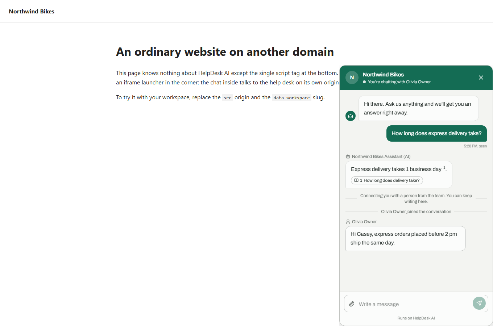
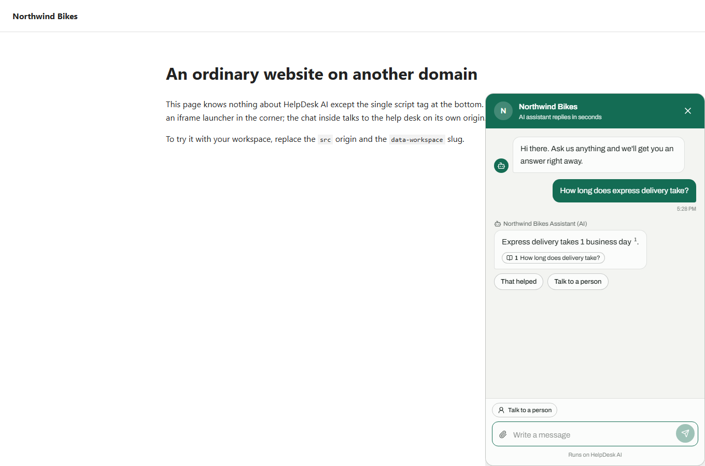
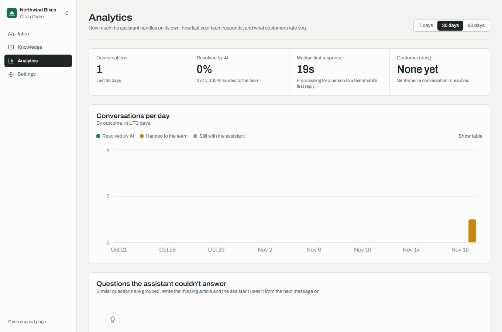
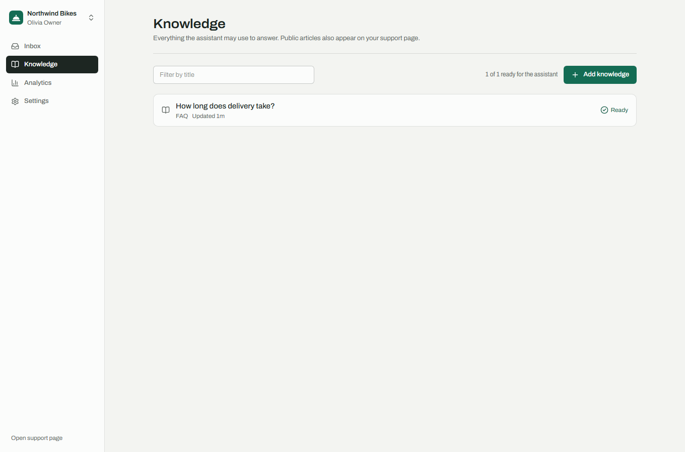
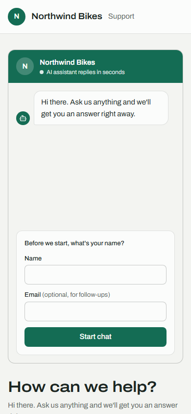

# HelpDesk AI

Customer support a small business can set up in five minutes. An AI assistant answers customers
first, grounded only in the business's own help articles and citing the one it used. When a
customer asks for a person (or the assistant can't answer), the same live conversation moves to
the team's inbox, an agent joins, and the customer rates the chat when it's resolved.

**Live:** https://helpdesk-ai-five.vercel.app


## What it does

**For the business owner**
- Sign up and create a workspace: name, support page address, brand color (curated, contrast-checked swatches), logo (Vercel Blob), greeting.
- Knowledge: write FAQ articles, paste text, or upload `.txt`, `.md` and `.pdf` files (parsed on the server, chunked, embedded with Gemini into pgvector). Articles can be public (listed on the support page) or internal.
- Assistant behavior: on/off, name, tone (friendly, professional, concise), what to do without an answer (offer a person or hand off right away), extra instructions, round-robin auto-assign.
- Install: one `<script>` tag that injects an iframe launcher on any website (cross-origin, mobile full-screen), plus a hosted support page `/s/<slug>` with the chat and public articles.
- Team: invite links (single use, 7-day expiry, hashed), admin and agent roles, live online status.
- Analytics: conversations per day by outcome, AI-resolved vs handed off, median first response time, average rating, and the top questions the assistant couldn't answer, each one click away from a drafted article built from what the agent actually told the customer.

**For the customer**
- A name (email optional) and they're chatting. The answer streams in within seconds with source links.
- "Talk to a person" is always there; asking in words works too.
- They see when a person joins, when they're typing, and when their message was read.
- Image and file attachments. A rating card when the conversation is resolved.
- Coming back later reopens the same conversation with its history.

**For agents**
- Queues: Unassigned, Mine, All open, Resolved, with live counts, unread badges and a timer for customers waiting on a first reply.
- Claim, or get conversations by round-robin among teammates who are online and available.
- Reply with text, images and files; saved replies; AI reply suggestions to insert and edit; internal notes the customer never sees; transfer; resolve and reopen.
- Customer context: name, email, the page and title they came from, past conversations.

| Widget on an external site | AI answer with source | Analytics |
| --- | --- | --- |
|  |  |  |

| Install | Knowledge | Support page on a phone |
| --- | --- | --- |
|  |  |  |

## How this uses Nexconn

Every support conversation is a Nexconn group channel. The customer and the agents use the Chat
SDK for Web in the browser; the server uses the Platform Chat API (signed requests, Singapore data
center) for everything a bot or the system does.

| Nexconn feature | How HelpDesk AI uses it | Where |
| --- | --- | --- |
| Access tokens / user registration (`/v4/auth/access-token/issue`) | Every teammate, every customer and each workspace's AI bot is a real Nexconn user (`hdk…` ids) | `src/lib/nexconn/server.ts`, `src/lib/workspaces/service.ts`, `src/lib/widget/service.ts` |
| Chat SDK init, `AreaCode.SG`, connect, connection status | One connection per page; reconnect banner, kicked-session (31010) handling, token refresh on 31004, manual reconnect on 33007, history resync after reconnect | `src/lib/nexconn/client.ts`, `src/components/app/staff-chat.tsx` |
| Group channels (server create) | One group per conversation (owner: bot, member: customer); one staff group per workspace | `src/lib/widget/service.ts`, `src/lib/workspaces/service.ts` |
| Group join / leave (server) | Claim adds the agent; transfer removes the old agent and adds the new one; invites and removals update the staff group | `src/lib/conversations/service.ts`, `src/lib/workspaces/service.ts` |
| Group profile update / dismiss | Staff group renamed with the workspace; test cleanup dismisses groups | `src/app/api/workspace/route.ts`, `scripts/cleanup-test-data.mjs` |
| Server-sent group messages | AI bot text replies, system lines, CSAT cards, internal notes broadcast, inbox events | `src/lib/ai/reply.ts`, `src/lib/conversations/service.ts`, `src/app/api/inbox/[id]/notes/route.ts` |
| Streaming messages (`RC:StreamMsg`, `/v4/group-channel/message/stream/send`) | Gemini output is streamed into one Nexconn streaming message; browsers fetch it with `getMessagesByIds` and receive chunks through `requestStreamMessage` + `onStreamMessageRequestDelta`; `RC_Ext_StreamMsgSummary` marks completion | `src/lib/ai/reply.ts`, `src/lib/nexconn/client.ts` |
| Custom message types | `HD:Event` (handoff, joined, transferred, resolved), `HD:Csat` (rating card), `HD:Note` (staff-only notes), and status types `HD:Typing`, `HD:Inbox`, `HD:Stream` | `src/lib/nexconn/types.ts`, `src/lib/nexconn/client.ts` |
| Message metadata (expansion) | Citations and final text on AI answers, "That helped" feedback, CSAT rating and comment written back onto the card; clients update live via `onMessageMetadataUpdated` | `src/lib/ai/reply.ts`, `src/lib/conversations/service.ts` |
| Read receipts | Messages are sent with `needReceipt`; the other side calls `sendReadReceiptResponse`; "Seen" comes from `onMessageReceiptResponse` | `src/lib/nexconn/client.ts`, `src/components/inbox/conversation-view.tsx`, `src/components/customer/use-customer-chat.ts` |
| Typing indicators | Group channels have no SDK typing call, so typing is a throttled custom status message (`HD:Typing`), also sent by the bot while it looks things up | `src/lib/nexconn/client.ts`, `src/lib/ai/reply.ts` |
| Unread counts | `BaseChannel.getUnreadChannels` for inbox badges, `clearUnreadCount` when a conversation is opened | `src/components/inbox/inbox.tsx` |
| History pagination | `BaseChannel.createMessagesQuery` loads the customer's conversation and older pages on scroll | `src/components/customer/use-customer-chat.ts` |
| Image and file messages | `Helper.createSendImageMessageParams` / `createSendFileMessageParams` + `sendMediaMessage` with upload progress, for customers and agents | `src/lib/nexconn/client.ts` |
| Presence | Server `/v4/user/connection-status/get` decides round-robin assignment and "team online"; the Team page subscribes to online status in the SDK | `src/lib/conversations/service.ts`, `src/components/settings/team-manager.tsx` |
| Sender info in message content | Agent replies carry `senderUserInfo.name` so customers see who answered | `src/lib/nexconn/client.ts` |

No console webhooks are used. The customer's browser calls our API after each successful SDK send;
the server verifies the customer owns the conversation, mirrors the message in Postgres, and runs
the AI pipeline in `after()`.

## Tech stack

Next.js 16 (App Router, TypeScript strict), Tailwind CSS 4, Drizzle ORM on Neon Postgres with
pgvector (768-dim HNSW), Vercel Blob, Gemini through `@google/genai` (models from env, retries with
backoff and a fallback model), Nexconn Chat SDK for Web 26.2 and Platform Chat API, zod, jose,
bcryptjs, lucide icons, Archivo + JetBrains Mono, Vitest and Playwright.

## Run it locally

```bash
npm install
vercel env pull .env.local --yes     # or create .env.local with the variables below
npm run db:migrate                   # applies drizzle/ migrations (enables pgvector)
npm run dev                          # http://localhost:3101
```

Environment variables (names only): `DATABASE_URL`, `DATABASE_URL_UNPOOLED`, `BLOB_READ_WRITE_TOKEN`,
`NEXCONN_APP_KEY`, `NEXCONN_APP_SECRET`, `NEXCONN_API_BASE`, `NEXCONN_ID_PREFIX`, `SESSION_SECRET`,
`GEMINI_API_KEY`, `GEMINI_MODEL`, `GEMINI_FALLBACK_MODEL`, `GEMINI_EMBED_MODEL`, optional `NEXT_PUBLIC_APP_URL`.

Try the widget on another origin: `npm run examples`, then open
`http://localhost:3199/external-site.html?origin=http://localhost:3101&workspace=<your-slug>`.
The file itself, `examples/external-site.html`, is a plain page with the one-line snippet.

## Tests

```bash
npm run test:unit                                   # Vitest: chunking, prompts, palette, slugs, credentials, SLA
npm run test:e2e                                    # Playwright against http://localhost:3101
E2E_BASE_URL=https://helpdesk-ai-five.vercel.app npm run test:e2e   # against production
node scripts/cleanup-test-data.mjs                  # remove @example.com test accounts and their groups
```

Latest results: Vitest 19/19; Playwright 3/3 against local dev and 3/3 against production
(`https://helpdesk-ai-five.vercel.app`, widget embedded on a page served from another origin).

The main end-to-end test uses three browser contexts (owner, invited agent, customer on a different
origin) against the real stack: sign-up, onboarding, knowledge indexing, grounded streamed AI answer
with a source link, handoff, claim, typing, real-time replies, read receipts, internal note,
transfer, resolve, CSAT, and the returning customer's history.

## Deploy

`vercel deploy --prod` (functions run in `sin1`, next to Neon and the Nexconn Singapore data center).
